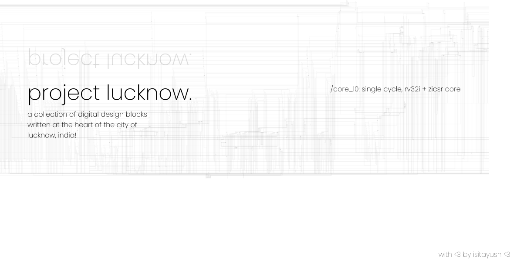

### lucknow.
"lucknow." is an open-source project where i'll publish a collection of
digital designs i've created at the heart of the city of lucknow, india!

### packages.
- ./core/l0
  - 32-bit, single-cycle, compute core
  - rv32i + zicsr
  - all code executes in machine mode (m-mode)
  - harvard memory architecture
  - traps follow the privileged spec (ecall, ebreak, illegal instruction, misaligned/out of bounds access)
  - no interrupts, no minstret
  - passes the official riscv-tests rv32ui suite and the rv32mi tests that apply to it (see below)
  - can be used as a design block in systems where a minimal ccu
  (central control unit) is required
  - educational/hobby purpose

- ./soc/k0 (work in progress)
  - core l0 plus the m extension (mul, mulh, mulhsu, mulhu, div, divu, rem, remu)
    and the a extension (lr.w, sc.w, and the nine word amos; one word reservation, any store clears it)
  - one memory map for both ports (qemu virt like): boot rom @ `0x0000_1000` (reset vector),
    ram @ `0x8000_0000`. the instruction port and the data port see the same ram, so code can
    be stored and run (`fence.i` works)
  - `valid/ready` style handshakes on both ports: the core stalls while a fetch or access is
    not ready, `bus.sv` can add wait states (`FETCH_WAIT`, `DATA_WAIT`) to model slow memory
  - uart @ `0x1000_0000`: transmit only, 16550 register layout (what the ns16550a driver and earlycon use),
    byte accesses, 8N1 at clk/`UART_CLKS_PER_BIT`; `UART_ECHO=1` prints the bytes in simulation
  - `soc.sv` wires the core to the bus; unmapped accesses, stores to the rom and non-byte uart accesses are access faults
  - passes riscv-tests rv32ui (including `fence_i`), rv32mi, rv32um and rv32ua, also with wait states
  - not done yet: interrupts (timer, clint), uart receive, more peripherals

### riscv-tests.
the cores are checked against the official [riscv-tests](https://github.com/riscv-software-src/riscv-tests) isa suites.
needs `riscv32-unknown-elf-gcc` (set `TOOLCHAIN` if it isn't in `/opt/riscv32/bin`); the suite is cloned on first use
into `core/l0/riscv-tests` (ignored by git).

```bash
./core/l0/riscv/run.sh            # everything
./core/l0/riscv/run.sh addi lw    # only some tests
./soc/k0/riscv/run.sh             # k0, includes rv32um

# k0 with slow memories (2 cycles per fetch, 3 per data access)
RV_IFLAGS="-Ptest_riscv.FETCH_WAIT=2 -Ptest_riscv.DATA_WAIT=3" ./soc/k0/riscv/run.sh
```

not run, because the feature doesn't exist in the core: rv32mi `illegal` (interrupts, vectored mtvec),
`instret_overflow` (minstret), `breakpoint` (debug triggers), and for l0 rv32ui `fence_i` (no writable instruction
memory); `ma_data` (misaligned data access in hardware) is skipped everywhere. the a extension tests only exist
for k0 (rv32ua, `RV_UA=1`).

a bare-metal program on k0 (builds `programs/<name>.S`, runs it, checks what the uart prints):

```bash
./soc/k0/programs/run.sh hello
```

### icarus processing.
> the following requires tools available in the
> [oss-cad-suite](https://github.com/YosysHQ/oss-cad-suite-build?tab=readme-ov-file#installation)

```bash
cd ./core/l0

# single module compilation (for example: alu.sv)
# every module has a matching ./tests/test_<module>.sv, they print "Test passed!" or "Test failed!"
iverilog -g2012 -o ./tests/results/test_alu.out ./src/shared.sv ./src/alu.sv ./tests/test_alu.sv
vvp ./tests/results/test_alu.out # generates a ./tests/results/test_alu.vcd file for gtkwave visualization

# top module compilation (control.sv), runs a small program and checks the registers
iverilog -g2012 -o ./tests/results/test_control.out -c compile.f # compile.f ensures order of compilation is maintained
vvp ./tests/results/test_control.out # generates a ./tests/results/test_control.vcd file for gtkwave visualization
```

### yosys processing.
```bash
cd ./core/l0

# start yosys
yosys

# inside yosys terminal
read -sv ./src/*.sv
hierarchy -check -top control
proc # convert design to strcutural repr.

# visualization processing
write_json ./arch/design.json # write a json netlist (processing by other tools)
show -format dot -prefix ./arch/design # write a dot for graphviz
```

### visualization.
```bash
cd ./core/l0
# if you've generated the dot file, you can visualize it with graphviz
dot -Tsvg ./arch/design.dot -o ./arch/design_dot.svg

# if you've generated a json file, i suggest you to use the pp_json.py
# first to simplify the module naming before using it with other visualization tools
python pp_json.py -i ./arch/design.json -o ./arch/pp_design.json
netlistsvg ./arch/pp_design.json -o ./design.svg # example of json netlist usage with another visualization tool
```

### license.

       ╱|、
     (˚ˎ 。7
      |、˜〵
     じしˍ,)ノ

the repository and everything within is licensed under the [GNU General Public License v3.0](https://www.gnu.org/licenses/gpl-3.0.en.html).
Refer to [COPYING.md](./COPYING.md) for the full license text.
